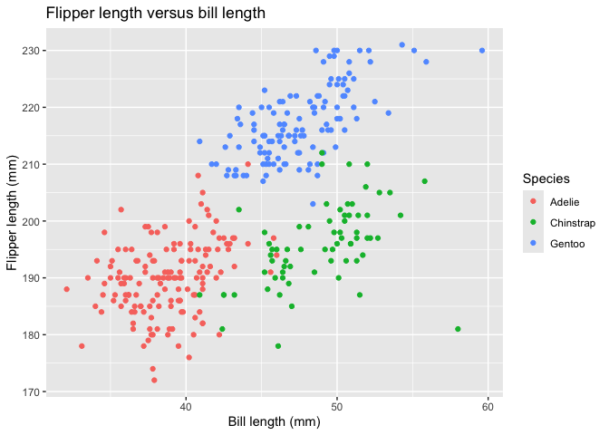

Homework 1
================
yl6378

## Problem 1

``` r
data("penguins", package = "palmerpenguins")
```

The penguins dataset contains measurements of penguins from the Palmer
Archipelago in Antarctica. It has 344 rows and 8 columns, with each row
representing an individual penguin.

Important variables include species (Adelie, Chinstrap, Gentoo), island
(Biscoe, Dream, Torgersen), bill length and bill depth (mm), flipper
length (mm), body mass (g), sex, and year. The observations span 2007 to
2009.

The mean flipper length is 200.92 mm, excluding 2 missing flipper length
measurements.

``` r
penguin_plot = ggplot(
  penguins,
  aes(
    x = bill_length_mm,
    y = flipper_length_mm,
    color = species
  )
) +
  geom_point(na.rm = TRUE) +
  labs(
    title = "Flipper length versus bill length",
    x = "Bill length (mm)",
    y = "Flipper length (mm)",
    color = "Species"
  )

penguin_plot
```

<!-- -->

``` r
ggsave(
  filename = "penguin_scatterplot.png",
  plot = penguin_plot,
  width = 7,
  height = 5,
  units = "in",
  dpi = 300
)
```

The scatterplot shows flipper length versus bill length, with different
colors identifying the three species. Gentoo penguins generally have
longer flippers than Adelie and Chinstrap penguins. Observations with
missing measurements for either plotted variable are omitted.

## Problem 2

``` r
set.seed(123)

variable_types = tibble(
  normal_sample = rnorm(10),
  is_positive = normal_sample > 0,
  character_values = c(
    "apple", "banana", "cherry", "apple", "banana",
    "cherry", "apple", "banana", "cherry", "apple"
  ),
  factor_values = factor(
    c(
      "low", "medium", "high", "low", "medium",
      "high", "low", "medium", "high", "low"
    ),
    levels = c("low", "medium", "high")
  )
)

variable_types
```

    ## # A tibble: 10 × 4
    ##    normal_sample is_positive character_values factor_values
    ##            <dbl> <lgl>       <chr>            <fct>        
    ##  1       -0.560  FALSE       apple            low          
    ##  2       -0.230  FALSE       banana           medium       
    ##  3        1.56   TRUE        cherry           high         
    ##  4        0.0705 TRUE        apple            low          
    ##  5        0.129  TRUE        banana           medium       
    ##  6        1.72   TRUE        cherry           high         
    ##  7        0.461  TRUE        apple            low          
    ##  8       -1.27   FALSE       banana           medium       
    ##  9       -0.687  FALSE       cherry           high         
    ## 10       -0.446  FALSE       apple            low

This data frame contains 10 observations and four variables: a random
sample from a standard Normal distribution, a logical indicator of
whether each sample value is greater than zero, a character variable
containing fruit names, and a factor with three levels. Setting a seed
makes the random sample reproducible.

``` r
mean(pull(variable_types, normal_sample))
```

    ## [1] 0.07462564

``` r
mean(pull(variable_types, is_positive))
```

    ## [1] 0.5

``` r
mean(pull(variable_types, character_values))
```

    ## Warning in mean.default(pull(variable_types, character_values)): argument is
    ## not numeric or logical: returning NA

    ## [1] NA

``` r
mean(pull(variable_types, factor_values))
```

    ## Warning in mean.default(pull(variable_types, factor_values)): argument is not
    ## numeric or logical: returning NA

    ## [1] NA

The mean of the numeric sample is 0.075. The mean of the logical
variable is 0.5, which represents the proportion of sample values
greater than zero. R treats TRUE as 1 and FALSE as 0 when calculating
this mean.

The character and factor variables both return NA with warnings. The
mean() function does not directly accept these variables as numeric
inputs.

``` r
as.numeric(pull(variable_types, is_positive))
as.numeric(pull(variable_types, character_values))
as.numeric(pull(variable_types, factor_values))
```

Converting the logical variable to numeric produces 1 for TRUE and 0 for
FALSE. This explains why its mean can be calculated directly.

Converting the character variable produces NA values and a warning
because the fruit names cannot be interpreted as numbers. Character
strings representing numbers could be converted, but the fruit names
used here cannot.

Converting the factor produces its internal integer codes: 1 for low, 2
for medium, and 3 for high, following the specified level order. These
codes represent categories rather than measured quantities. Although
their mean could be calculated after conversion, it would not establish
a meaningful average of the original categories. The original factor
cannot be averaged directly.
